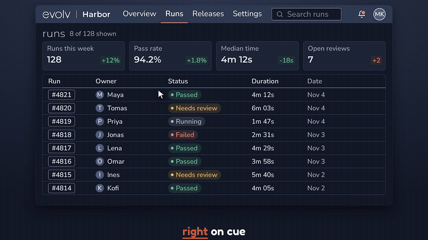

# explainer-video-kit

**Explainer videos for your project, made by Claude Code: voice, a moving cursor, callouts, camera moves, word-timed subtitles and music, from one script and a few screens.**

[](media/hero.mp4)

[▶ Watch the full video, 1:57, with sound](media/hero.mp4). It was made by the plugin; the sources are in [examples/hero](examples/hero).

---

## What you get

- **A drawn cursor** that glides to the right spot, clicks, and sends out a ripple.
- **Callouts** with corner brackets and a tag (pink by default, any colour you set), locked to a real element on screen. The starter templates already use them, with the cursor and an eased pan.
- **Camera moves** with eased pan and zoom, so the viewer's eye goes where the voice goes.
- **Word-timed subtitles** burned in, with the spoken word highlighted. SRT, VTT and chapter files come along.
- **Voice** from ElevenLabs v4, with emotion tags like `[warm]` to steer the delivery.
- **A music bed** that ducks under the voice and lands at -16 LUFS. `ev music <pixabay track page>` fetches a track and saves its licence record; the music is yours to pick and isn't bundled.
- **The evolv end card, the Gleam**: projects made with `ev init`, and any project that uses the evolv logo, end on a memorable evolv-branded card: a light sweeping along the orange line, catching the title letters, the panel edges and the large e mark. It takes your title and call to action from project.json. Any other project gets it only when you add an `endcard` block (see [End card](#end-card)).
- **Your look**: a `theme` in project.json sets the colours and fonts for the canvas, subtitles and callouts, and your own film.js can still define a different live end card scene. `render.sharpen` adds an optional pass for crisper screen text.
- **Quality gates** that fail the build when something's wrong (see below).
- **Contact sheets and a review page** so a reviewer can scrub the cut without opening a player.
- **Cost before you spend**: `ev voice --dry-run` shows the requests and characters first, and the credits once you've run a take once.

| Automatic | You bring |
|---|---|
| Script lint, captions, camera and cursor timing, audio mix, render, gates | Your app's screens and a short script |
| Everything except the voice, with no key at all | An ElevenLabs key, for the voice only |

## Quick start

1. Install the plugin in Claude Code:
   ```
   /plugin marketplace add evolvconsulting/explainer-video-kit
   /plugin install explainer-video@explainer-video-kit
   ```
2. Ask Claude: **"set up explainer-video"**. It installs the render browser and checks your machine, once per machine. You never type an engine path.
3. Restart Claude Code and ask: **"Make an explainer video of this app."** Or ask Claude for a sample video: it renders one with no voice and no key.

## Keys

The voice uses ElevenLabs. **Bring your own key; none is bundled.** Put `ELEVENLABS_API_KEY=...` in `<project>/.env` (copy `.env.example`; it's gitignored) or in `~/.config/explainer-video/.env`, or point `ev voice` at a file with `--key-file`. Never paste it into a chat. ElevenLabs' free tier doesn't allow commercial use. With no key, everything still renders except the voice, and `ev doctor` tells you what's missing.

## Built-in quality checks

A failed gate fails the build.

- **On-screen text:** OCR catches forbidden strings, and a blank first frame. It needs tesseract: without it this gate fails, so install it or opt out with `--skip-ocr`.
- **Muddy wipes:** cross-fades between different layouts get flagged.
- **Captions match the audio:** same words, same order, no stray tags.
- **Tags not spoken:** voice directions never reach the ear or the screen.
- **Audio spec:** -16 LUFS, true peak under -1 dBTP, music about 6.5 dB under the voice (gap band 5 to 8 dB). The voice take is also checked for a stray thump or click alone in silence (the message gives its time, and `ev voice --trim` cuts it out for free). These levels are taste calls set from a listener's ear: change them in project.json with `gates.audio.lufs`, `gates.audio.gap` and `music.bed`.
- **Whisper match:** your script heard back by a second listener. Under 98 percent warns, under 90 fails.
- **Camera windows:** no forbidden part of the page swept into view.
- **Callout fit:** every callout's brackets frame the real element, stay inside the frame, and vanish when their time is up.
- **Caption fit:** no caption line wider than the frame.
- **Leaked keys:** anything shaped like an API key fails.

## End card

The Gleam is the card an `ev init` project ends on (and any project that uses the evolv logo): a navy band with your title and the large evolv e mark, the orange line, and one or two install or call-to-action lines. A light sweeps along the line, the title letters catch it and fade back, and the edges of the panel and the e mark pick up the glint. The look and motion are fixed; only the words change.

The card is on by default for every `ev init` project: `ev init` writes an `endcard` block into project.json with your title and a placeholder line, so your first build already ends on it. `ev doctor` and `ev build` warn while the placeholder is still there. Replace it, or opt out with `"endcard": "none"`. The block, filled in:

```json
"endcard": {
  "title": ["explainer-video,", "a Claude Code plugin"],
  "lines": ["/plugin marketplace add evolvconsulting/explainer-video-kit", "/plugin install explainer-video@explainer-video-kit"],
  "note": "Needs: Claude Code, Node 22+, ffmpeg, tesseract."
}
```

- `title`: one string, or 1 to 2 lines. Defaults to the project `title`.
- `lines`: 0 to 2 call-to-action lines, each in a code box with an orange `>`.
- `note`: one small line under the boxes (optional).
- `at` and `dur`: the card starts just before the last beat (`"last-beat"`, the default) and runs 12 s. Give seconds or `"beat:N"` to move it, and `dur` (3.2 or more) to change its length.

The card covers the screen from the last beat on, so make the last beat of script.md a short closing line, not content. The three starter templates already end that way. A line that is too wide for its box shrinks to at most 70 percent of its size and then ends in an ellipsis. These are errors from `ev doctor` and `ev build`: more than 2 title lines or 2 `lines`, no title at all, an `at` in seconds past the end of the film, or a `beat:N` past the last beat.

The card is made for 16:9 (any 16:9 frame size). For another shape `ev build` skips it and says so. To switch it off set `"endcard": "none"`. To use your own end card, define `window.SCENES.endcard` in film.js, or put your own scene event at or after where the card would start, and the engine adds nothing. What counts as at or after: a `beat:N` anchor with N at or after the card's beat (the last beat), with any offset; a number at or after the card's start; a `word:` anchor (or a `beat:N` when `at` is in seconds) whose time is at or after the card's start, judged from `build/captions.json`, which exists from the first build on. A scene earlier in the film does not count. A project with no `endcard` key at all gets the card only if it uses the evolv logo (`"brand": "evolv"`, or an evolv-logo or evolv-icon asset in `theme/` or `mockup/`). `ev build` always prints one line saying what it decided.

The card's e mark, fonts and colours come from the evolv-brand skill, vendored in `plugins/explainer-video/engine/assets/evolv-brand` (`node tools/vendor-brand.mjs --check` reports drift). Its fonts are Montserrat and Nunito Sans; the engine adds them to the composition unless your `theme` already loads them.

## Quick or long

A quick explainer of about a minute is the default (`ev init demo`). For chapters and a longer film, `ev init demo --form long`.

## Requirements

| Needed | For |
|---|---|
| Node 22+ | the engine |
| ffmpeg and ffprobe | audio mix, frames, gates |
| tesseract (required) | the on-screen text gate: without it that gate fails; opt out with `--skip-ocr` |
| ElevenLabs key | the voice only |

Needs: Claude Code, Node 22+, ffmpeg, tesseract. ElevenLabs key for the voice.

Tested on Linux and WSL; macOS and Windows support is written but not yet tested. `ev setup` installs the render browser and runs `ev doctor`.

## More

Each step is its own skill, with the reasoning and numbers behind the rules: [plugins/explainer-video/skills](plugins/explainer-video/skills). Run `ev help` for every command.

## Licence

MIT. The bundled Fredoka font is SIL OFL 1.1. HyperFrames is Apache-2.0.
